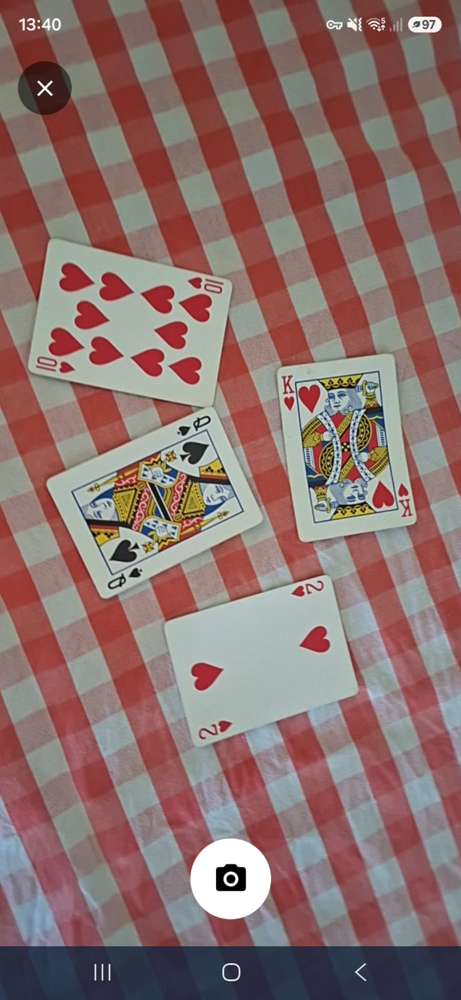
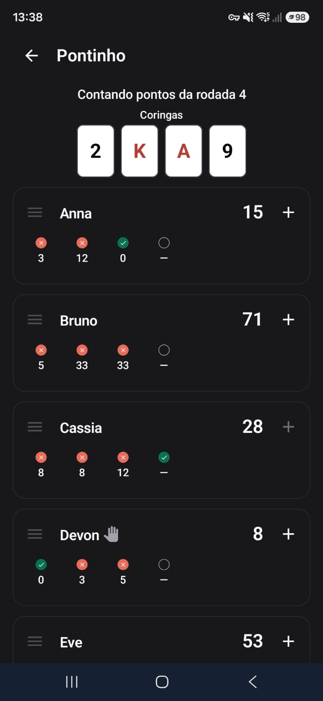
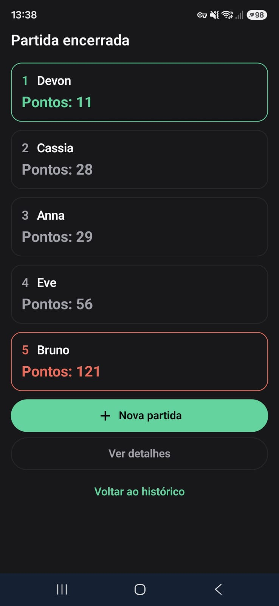
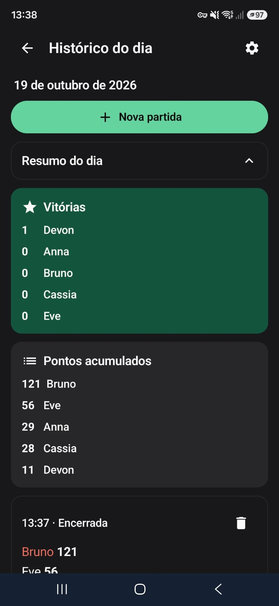

# Pontinho

Pontinho is an offline Android scorekeeper for the Brazilian card game of the
same name. It manages players, rounds, jokers, scores, match history, and an
optional camera-assisted flow that recognizes the cards left in a player's
hand.

The application is available in Brazilian Portuguese and US English. It does
not require an account, ads, analytics, or an internet connection.

<p align="center">
  
  
  
  
</p>

## Camera-assisted scoring

The scanner is the project's main feature. From a player's score dialog, tap
the camera action, choose the round's wildcard, and photograph every card left
in the hand. Pontinho runs the bundled 52-class detector locally with LiteRT,
maps the detections back to the photo, removes duplicate boxes, applies the
game's scoring rules, and presents the recognized cards and calculated total
for review.

Camera use is optional. The app explains its processing before requesting the
Android camera permission, does not upload or retain the photo, and always
offers manual score entry. Recognition is assistive rather than authoritative:
lighting, glare, overlap, unusual decks, and partially visible cards may reduce
accuracy. The user must review and may correct every recognized card before a
score is saved.

## Features

- Create matches, reuse player rosters, and choose the opening dealer.
- Track rounds, accumulated totals, the current wildcard, and the match winner.
- Reorder, rename, add, or remove players while preserving match state.
- Correct earlier scores and continue unfinished matches.
- Browse and delete locally stored match history.
- Learn the rules through the built-in illustrated guide.
- Switch between Brazilian Portuguese and US English.
- Scan cards entirely on-device or enter every score manually.
- Continue using the scorekeeper on devices without a camera.

## Privacy

Player names, preferences, matches, recognition metadata, and scores remain on
the device. Backups are disabled, temporary camera files are excluded from
Android backup rules, and the release manifest contains no internet permission.
The scanner uses the camera only while its screen is open.

The repository includes a publication draft of the
[privacy policy](docs/legal/privacy-policy-draft.md). A release publisher must
set its effective date, publish it at a stable public URL, and use that URL in
the store listing.

## Technology

- Kotlin and Jetpack Compose with Material 3
- Room for local match data and DataStore for preferences
- Navigation Compose and lifecycle-aware ViewModels
- CameraX for capture and preview
- LiteRT for the bundled YOLOv8n card detector
- Gradle version catalogs, KSP, JUnit, Robolectric, Espresso, and Compose UI tests

The Android module uses `minSdk 26`, `targetSdk 36`, and `compileSdk 37`.

## Build and verify

Install Android SDK 37 and use the repository's Gradle wrapper. The checked-in
daemon toolchain configuration selects Java 25.

```powershell
.\gradlew.bat assembleDebug
```

Install the debug APK from
`app/build/outputs/apk/debug/app-debug.apk`, or run the `app` configuration from
Android Studio.

The release-candidate verification task runs the unit suite and release lint,
builds the APK and App Bundle, checks that camera hardware remains optional,
confirms that scanner dependencies work offline, validates the model and its
metadata, and verifies 16 KB alignment for packaged native libraries.

```powershell
.\gradlew.bat verifyUnsignedReleaseCandidate
```

The generated release artifacts are unsigned. Production distribution still
requires the publisher's protected upload key and Play App Signing setup.

## Project layout

- `app/` contains the Android application, resources, tests, and bundled model.
- `ml/card-recognition/` contains training, evaluation, export, and provenance tooling.
- `docs/licenses/` records model and dataset provenance and release limitations.
- `docs/legal/` contains the privacy-policy publication draft.
- `artwork/` contains source artwork for the application icon.
- `design/` contains retained product design references.

## Distribution checklist

Before publishing a build, the publisher must:

- keep the complete corresponding source and model materials publicly available
  at [`github.com/MaxMFonseca/PontinhoApp`](https://github.com/MaxMFonseca/PontinhoApp);
- publish the privacy policy and add its active URL to the store listing;
- review and complete the Play Console Data safety and App content declarations;
- build and upload a signed Android App Bundle with the publisher's keys;
- provide the required store listing, screenshots, contact details, and testing
  track information; and
- preserve the license, notices, model provenance, and complete source required
  by the AGPL.

## License and provenance

Pontinho and its complete corresponding source are licensed under the
[GNU Affero General Public License v3 or later](LICENSE). AndroidX, Jetpack
Compose, Room, CameraX, and LiteRT are used under their applicable Apache 2.0
licenses. The training package uses Ultralytics under AGPL-3.0.

The release model was trained from the Playing Cards Object Detection version 4
dataset published by Augmented Startups and declared Public Domain in the
recorded provider metadata. The model is owner-approved for this release, but
it has not passed the stronger independent benchmark described in the project
records. See [NOTICE.md](NOTICE.md) and the complete
[card-recognition provenance record](docs/licenses/card-recognition.md) before
redistributing the app or model.
